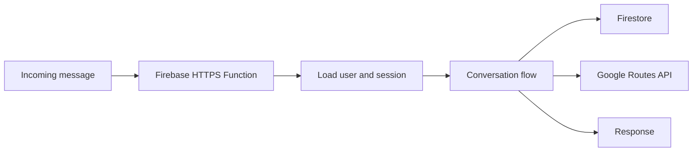

# Naavi Chatbot

Naavi is a conversational assistant project focused on fitness routines and user support. This repository contains its serverless backend, built with Firebase Cloud Functions and TypeScript.

The backend receives messages through an HTTP endpoint, identifies the user, manages conversation state, and routes each interaction through the appropriate flow. It also uses Firestore to store session and subscription data.

## Features

- HTTP webhook for processing incoming messages
- Conversation flows for onboarding, menus, user profiles, and route-related interactions
- User session and subscription persistence with Cloud Firestore
- Support for message payloads containing text, media, and location data
- Route optimization through the Google Routes API
- Firebase Cloud Functions deployment

## Tech stack

- TypeScript
- Node.js 22
- Firebase Cloud Functions
- Firebase Admin SDK
- Cloud Firestore
- Twilio
- Google Routes API

## Architecture



## Project structure

```text
.
├── functions/
│   └── src/
│       ├── bot/         # Conversation routing and flows
│       ├── config/      # Environment configuration
│       ├── handlers/    # HTTP handlers
│       ├── models/      # Data types
│       ├── sevices/     # Firestore, user, route, and messaging services
│       └── index.ts     # Cloud Functions entry point
├── firebase.json
├── firestore.rules
└── storage.rules
```

## Run locally

### Prerequisites

- Node.js 22
- Firebase CLI
- A Firebase project with Cloud Functions and Cloud Firestore configured

### Setup

```bash
git clone https://github.com/diego-lanca/naavi-chatbot.git
cd naavi-chatbot
firebase login
firebase use --add
cd functions
npm ci
npm run build
npm run serve
```

The `serve` script starts the Firebase Functions emulator. Configure the required Firebase and external service credentials before running flows that depend on them.

## Configuration

The backend reads these values from the environment:

- `TWILIO_SID`
- `TWILIO_AUTH`
- `TWILIO_FROM`
- `TWILIO_MESSAGE_SID`
- `GOOGLEAPI_KEY`

Keep credentials outside the source code and never commit real API keys or tokens.

## Deployment

After selecting and configuring your Firebase project:

```bash
cd functions
npm run build
npm run deploy
```

## Project status

This repository is a learning and development project. Its public code focuses on the Firebase backend, conversation flows, persistence, and external service integrations.
